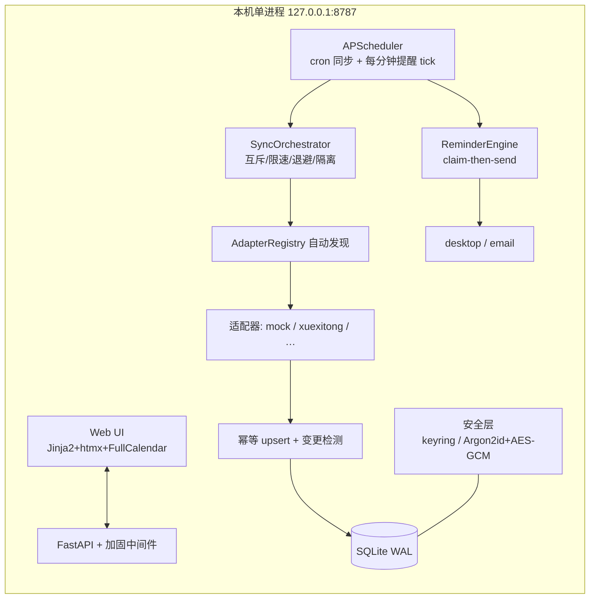

# DDLHub

**本地优先**的课程作业 DDL 聚合与提醒工具。只在你自己的电脑上运行：录入平台账号 →
自动拉取所有课程的作业与截止时间 → 汇总成统一时间线 → 多级提醒 + DDL 变更通知。

> **凭据不出本机**：密码只存系统钥匙串（Windows 凭据管理器），会话 AES-256-GCM 加密存 SQLite，
> 日志与 API 响应全程脱敏。不搭云端、不上传任何数据。

## 快速开始（Windows）

```bat
start.bat
```

自动：建 venv → 装依赖 → 启动服务（`127.0.0.1:8787`）→ 打开浏览器。
首次启动无预置账号：去「设置」添加平台（学习通 / 中国大学MOOC / 智慧树 / U校园 / iWrite / 自定义平台）。

### 接入学习通

设置 → 添加平台 → 选「学习通（超星）」→ 保存后**自动弹出 Edge**：完成一次账密登录
（含可能的滑块验证码/扫码，工具不绕过任何验证）→ 会话加密保存并自动同步。
会话失效时账号显示「需要重新登录」，一键重弹浏览器。

### 平台支持状态

| 平台 | 登录 | 作业抓取 |
|---|---|---|
| 学习通（超星） | ✅ 有头浏览器人工登录 | ✅ 已校准 |
| 中国大学MOOC（大学慕课） | ✅ | ⏳ 待校准（登录后提供页面样本即可接入） |
| 智慧树（知到） | ✅ | ⏳ 待校准 |
| U校园 | ✅ | ⏳ 待校准 |
| iWrite 写作平台 | ✅（与 U校园共用 Unipus SSO） | ⏳ 待校准 |
| 自定义平台 | ✅ 填登录页 URL 即可 | ➖ 仅登录保活（抓取需开发适配器） |


## 功能

- **三视图**：时间线（默认剩余时间升序、置顶在前）/ 列表 / 日历；筛选：平台、课程、完成状态、未来7天
- **操作**：标记完成、忽略、置顶（本地字段，同步永不覆盖）；每张卡片可覆盖提醒档位
- **提醒**：默认 T-7d / T-3d / T-1d / T-6h / T-1h，重要作业自动加 T-12h；已提醒节点不重复轰炸；
  标记完成/平台已提交立即停止；逾期只提醒一次；错过多个节点只补发最近一个
- **变更通知**：老师改 DDL / 临时加作业 → 单独一条变更通知（同一变更不重发）
- **课程选择**：按账号勾选要跟踪的课程，关闭即不抓取不展示
- **渠道**：桌面 Toast（winotify）+ 邮件 SMTP，设置页开关；渠道层可插拔（加渠道 = 1 个文件）
- **每日自动同步** 08:00/21:00（可配），手动"立即同步"随时可用；自动抓取间隔红线 ≥10 分钟

## 架构



- **适配器机制**：新增平台 = `adapters/<key>.py` 一个文件（含 `@register("key")` 一行），
  见 [docs/ADAPTER-GUIDE.md](docs/ADAPTER-GUIDE.md)；解析函数用 fixture 离线回归。
- **幂等与变更检测**：`(account_id, source_id)` 唯一键 upsert；`due_at` 一律 UTC；
  变更 → `change_hash` 防重发。
- **提醒引擎**：每分钟从 DB 现算节点 + `UNIQUE(dedupe_key, channel)` 去重 → **进程重启后提醒计划自然恢复**。

## 安全说明

| 项 | 方案 |
|---|---|
| 密码 | 系统钥匙串（Windows Credential Manager）；启动时断言后端白名单，**拒绝任何明文后端**；跨平台兜底 = 主密码 vault 模式（Argon2id + AES-256-GCM，主密码仅在启动时交互输入、不落盘；因此 vault 模式需交互终端、不适合开机自启——Windows 用户请保持默认钥匙串模式） |
| 会话 | 登录票据（cookie/storage_state）AES-256-GCM 加密落库；有头登录用内存态浏览器上下文，磁盘无明文 |
| 日志 | 全局 Formatter 正则清洗 `password/token/cookie=… → ******`；异常入库前过 `redact()` |
| Web | 默认只监听 127.0.0.1；Host 白名单反 DNS rebinding；非 GET 校验 Origin/Sec-Fetch-Site；会话 cookie（HttpOnly SameSite=Strict）鉴权。LAN 模式（`DDLHUB_LISTEN=lan`）为明文 HTTP + 令牌交换，仅限家庭可信网络 |
| 验证 | `tests/test_redaction.py` 自动化：日志流与 SQLite 字节全文搜索无明文 |

## 部署（开机自启）

1. 双击 `start.bat` 确认能正常启动后关闭；
2. `Win+R` 输入 `shell:startup` 回车 → 把 `start.bat` 的**快捷方式**放进去 → 开机自动启动（窗口最小化即可）。
   或用任务计划程序：操作=启动 `start.bat`，触发器=登录时。
3. 手机访问：`.env` 里 `DDLHUB_LISTEN=lan` → 重启 → 手机访问 `http://<电脑IP>:8787/?token=<.env 里的 DDLHUB_TOKEN>`
   （首次打开自动换成 Cookie）。⚠ 明文 HTTP，仅限可信局域网。
4. 数据备份：拷贝 `data/` 目录即可（数据库 + 加密会话；钥匙串凭据不随文件迁移，换机需重新登录一次）。

## 开发

```bash
python -m venv .venv
.venv\Scripts\pip install -e ".[dev,real-adapters]"
.venv\Scripts\playwright install chromium   # 真实平台适配器需要
.venv\Scripts\pytest                        # 65 个用例
.venv\Scripts\python -m ddlhub
```

## 免责声明 / 使用边界

- 本工具**只抓取你自己账号**可见的作业数据，频率默认每日两次（≥10 分钟下限），仅供个人学习安排使用。
- **不做且不会做**：绕过验证码/滑块、破解加密、伪造请求头绕过风控、抓取他人账号、云端收集账号。
- 登录遇到验证码/扫码时，工具弹出有头浏览器由**你本人完成验证**，不代替、不绕过。
- 使用本工具请遵守目标平台的服务条款与学校规定；抓取行为产生的账号风险由使用者自负。
- 学习通等平台无官方开放 API，页面改版可能导致解析失效（表现为同步失败而非数据错乱），
  需按 `docs/ADAPTER-GUIDE.md` 重录 fixture 校准。
