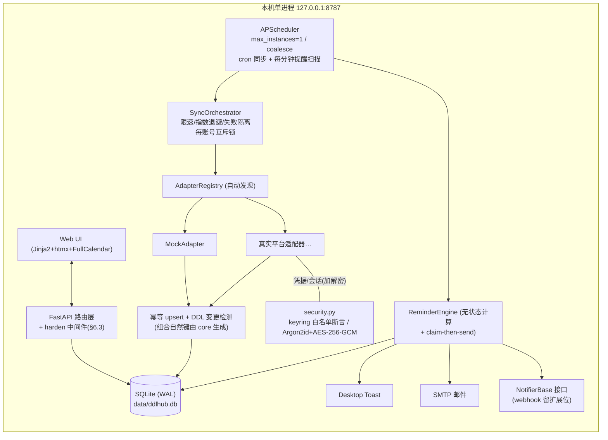
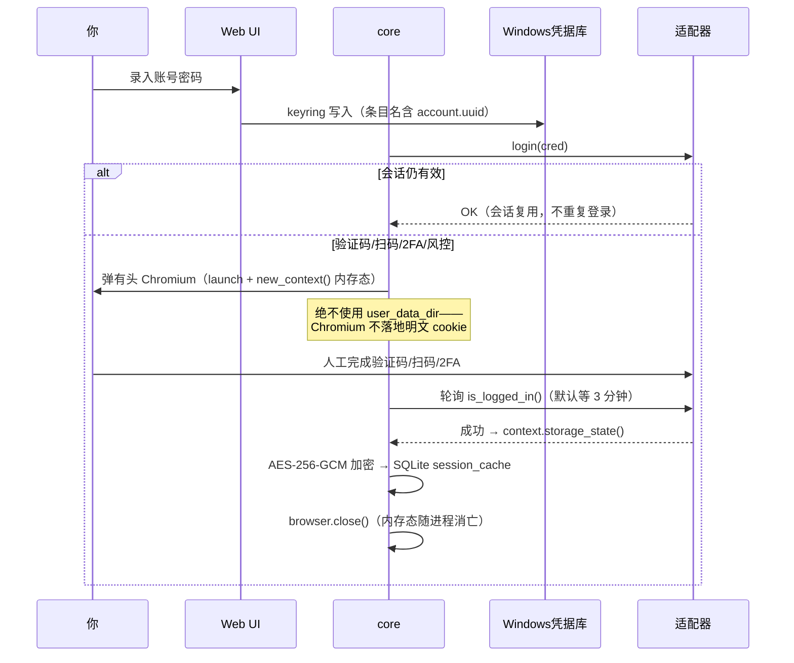

# DDLHub 设计文档（Phase 1 · v2 评审修订版）

> 定位：**只在你自己电脑上运行**的课程作业 DDL 聚合与提醒工具。
> 输入账号密码 → 自动登录各平台 → 汇总全部作业 DDL → 多级提醒 + 变更通知。

**v2 修订说明**：首轮设计评审 7 项 P0 / 11 项 P1 / 12 项 P2 **全部采纳**；其中 P0-2、P1-8、P1-11 及依赖声明二选一在落地方式上有细化或取舍，见 §0.1。未改动的核心定位：单进程 + APScheduler 线程池跑 Playwright 同步 API、UTC 落库、`UK(source_id)` 幂等、本地字段永不被同步覆盖、`dedupe_key` 防轰炸、`change_hash` 防噪声、有头人工登录是一等公民、验收项逐条映射到测试。

---

## 0. 需求输入确认（已逐项确认，非假设）

| 项目 | 结论 | 对设计的影响 |
|---|---|---|
| 操作系统 | Windows 11（环境已确认） | 凭据默认走 Windows Credential Manager；桌面通知用 Windows Toast |
| 统一身份认证 | 无 CAS/OAuth，各平台独立登录 | 不做 CAS 模块；若某平台实际会跳统一认证，由该平台适配器内部处理，接口不变 |
| 验证码/扫码 | **经常遇到** | 「有头浏览器人工登录一次 + 保存加密会话」是一等公民路径，会话复用率是核心指标（TTL 门槛见 §12） |
| 通知渠道 | 桌面 + 邮件（SMTP）即可 | 不实现具体 Webhook，但渠道层保留可插拔接口（新增渠道 = 1 个文件） |
| 手机访问 | 需要（局域网） | UI 响应式；`LISTEN=lan` 开关 + token→HttpOnly Cookie 一次性交换（§6.3）；默认仍只监听 127.0.0.1 |
| 第一个真实平台 | 你将在阶段 3 前告知 | 接入流程按 `docs/ADAPTER-GUIDE.md`（**阶段 3 产出**，README 阶段 4 引用它，两处口径已统一） |

## 0.1 修订记录（评审意见 → 处理落点）

| # | 结论 | 落点 |
|---|---|---|
| P0-1 discover 不可运行 | 采纳：`discover()` 移入 `adapters/__init__.py`（用包级 `__path__`），跳过 base/registry，**逐模块 try/except**（一个坏文件不拖垮启动） | §5.3 |
| P0-2 keyring 静默明文降级 | 采纳+细化：启动时**后端白名单断言**；白名单外一律禁用 keyring → 无安全后端时必须显式启用主密码 vault 模式，**系统里不存在任何明文路径** | §6.1 |
| P0-3 dedupe 键缺 channel | 采纳：`UNIQUE(dedupe_key, channel)` + **claim-then-send 状态机**（pending→sent/failed/skipped，attempts 上限），顺带解决并发双发 | §4 / §8.2 |
| P0-4 补发风暴 / overdue 轰炸 | 采纳：同作业错过多节点**只补发最近 1 个**（更早的置 skipped）；overdue **双护栏**（`first_seen_at < due_at` 且逾期 ≤ 7 天） | §8.2 |
| P0-5 localhost 无鉴权 | 采纳：Host 头白名单（反 DNS rebinding）+ 非 GET 校验 Origin/Sec-Fetch-Site + **本地模式也下发 HttpOnly 会话 cookie 做鉴权** | §6.3 |
| P0-6 账号缺当前状态 | 采纳：ACCOUNT 增 `status / last_ok_at / last_error`（`enabled` 字段取消，由 status 表达） | §4 |
| P0-7 同步无互斥 | 采纳：每账号进程内锁（非阻塞获取，手动同步立即得到"已在同步中"反馈）+ APScheduler `max_instances=1, coalesce=True, misfire_grace_time=3600`（同时解决休眠唤醒后 cron 集中补跑）；change 通知同样走 claim 机制防双发 | §7.1 / §8.2 |
| P1-8 source_id 仅课程内唯一 | 采纳+细化：**组合自然键由 core 统一生成** `f"{course_source_id}::{draft.source_id}"`——适配器无从拼错，不依赖注释约定；`ASSIGNMENT.account_id` 保留并用**复合外键** `(course_id, account_id) → course(id, account_id)` 保证两列一致 | §4 / §5.1 / §5.6 |
| P1-9 keyring 条目名用 label | 采纳：ACCOUNT 增不可变 `uuid`，条目名 `ddlhub/<adapter_key>/<uuid>`；label 仅展示、可编辑、可重名 | §4 / §6.1 |
| P1-10 持久化 profile 明文写盘 | 采纳：有头登录一律 `browser.new_context()` **内存态 context** + `storage_state()` 加密落库；**禁用 user_data_dir** | §5.4 |
| P1-11 docker 与 keyring 冲突 | **取舍：删除 docker-compose 交付物**（而非保留加警告）——三重冲突（容器读不到 Windows Credential Manager、WAL 在 bind mount 上不可靠、有头人工登录无显示器），留着只会误导。容器场景的唯一正解是主密码 vault 模式，而这与"数据不出本机"的易用性相悖，不作为交付路径 | §1 / §11 |
| P1-12 会话 TTL 无验证点 | 采纳：**阶段 3 第一个交付项 = 实测会话 TTL**，门槛 ≥24h；不足则低频心跳保活（health_check 当保活，频率仍在 ≥10min 红线内）或改同步时刻；均无效则 UI 明示"该平台会话易失" | §12 |
| P1-13 已提交作业仍提醒 | 采纳：`effective_done = local_done or status == "submitted"`；UI 区分"平台已提交"与"本地标记完成"两个来源 | §8.1 / §9 |
| P1-14 due_at 空值矛盾 | 采纳（选可空方案）：`due_at` 可空；无截止作业**不丢弃**，UI 单独分组展示，永不进提醒引擎 | §4 / §9 |
| P1-15 偏移正负号不一致 | 采纳：全程 `minutes_before` 正数（10080=提前 7 天），env、落库、dedupe_key、UI 文案一个口径 | §8 |
| P1-16 单作业覆盖放 app_setting | 采纳：ASSIGNMENT 增列 `reminder_offsets_json`（随作业行级联，无孤儿数据） | §4 |
| P1-17 迁移/索引/保留三缺 | 采纳：`schema_version` 表 + 手写 `migrations/NNN_*.sql` 启动顺序执行（不用 Alembic）；索引 `(due_at)` / `(local_done, status)` / `course(account_id)`；SYNC_RUN 30 天保留（并入每日清理任务） | §3 / §4 / §7 |
| P1-18 LAN token 走 query+明文 HTTP | 采纳：`?token=` 一次性交换 → 写 HttpOnly Cookie → 302 重定向清掉 URL；UI 明示"同一 WiFi 下他人可嗅探" | §6.3 |
| P2 ×12 | 全部采纳，落点：CourseDraft/Health/AdapterContext 补定义（§5.1）；依赖声明二选一选 `pyproject.toml` 单源（§11）；`.env.example` 逐行修正（§11）；change_hash 单值限制 → 已知限制（§14）；OneDrive 路径检测告警 + `DDLHUB_DATA_DIR`（§11）；winotify"发送测试通知"按钮（§8.4）；FullCalendar 用 v6 standard bundle（`index.global.min.js`，MIT 核心，本地 vendored）（§9）；ADAPTER-GUIDE 统一为阶段 3 产出（§0/§12）；时区变更不迁移历史数据的口径说明（§14） | 各节 |

---

## 1. 技术选型：**B（Python: FastAPI + SQLModel + APScheduler + Playwright）**

### 对比

| 维度 | A: Next.js 15 + Drizzle + TS | B: FastAPI + SQLModel + APScheduler | 胜出方 |
|---|---|---|---|
| 定时任务/常驻 worker | Next 生命周期面向请求，dev 模式 HMR 会杀掉常驻定时器；必须拆出独立 worker 进程 | APScheduler 与 API 同进程，天然常驻 | **B** |
| 系统钥匙串（安全重点） | keytar 已归档停维护；argon2 常需 node-gyp，Windows 编译易翻车 | `keyring` 直连 Windows Credential Manager，pip 即装；`argon2-cffi` 预编译 wheel | **B** |
| 加密原语 | node:crypto 需手拼 AES-GCM 流程 | `cryptography`（AESGCM 一行） | 平 |
| Playwright | 同一引擎 | 同一引擎，同步 API 写适配器更直白（线程池执行） | 平 |
| 前端 | React + Tailwind 生态最强 | Jinja2 + htmx + FullCalendar（本地 vendored）补齐 | A |
| 安装体积 / 5 分钟验收 | node_modules 数百 MB + Chromium | venv + wheel；Chromium 仅接真实平台时按需下载 | **B** |
| 学生自己维护/排错 | 需熟练 TS 全栈 | 单语言；FastAPI 自带 `/docs` | **B** |

### 结论理由（浓缩）
1. **凭据安全是红线**：Python 侧两个关键库在 Windows 上免编译即用，Node 侧一个停维护、一个要编译，风险不对称。
2. 常驻后台任务（cron 同步 + 每分钟提醒扫描）APScheduler 同进程搞定，"一键启动"真的是一个进程。
3. 前端只是三视图 + 筛选 + 操作按钮，htmx 足够；省掉 Node 工具链让 5 分钟验收必然达成。日后可平迁 Vite+React，API 不变。

### 启动方式
- **唯一交付路径**：`start.bat`（Windows）——建 venv → `pip install -e .`（依赖唯一声明在 `pyproject.toml`，不再有 requirements.txt）→ 初始化 DB/迁移 → 启动 `127.0.0.1:8787` → 自动开浏览器。Chromium 仅在接入真实适配器时按需 `playwright install chromium`，Mock 演示零浏览器依赖。
- **不提供 docker 路径**（P1-11 取舍，理由见 §0.1）。

---

## 2. 总体架构（单进程，默认只监听 127.0.0.1:8787）



**关键工程约束**：Playwright **同步 API** 不能跑在 uvicorn 的 asyncio 事件循环里 → 同步编排固定在 APScheduler 的线程池执行；FastAPI 路由只读写数据库并触发任务，不直接跑浏览器。SQLite 开 WAL、每线程独立连接。

---

## 3. 目录结构

```
ddlhub/
├─ ddlhub/
│  ├─ __main__.py            # python -m ddlhub：init/migrate db → 启动调度器 → 起 uvicorn
│  ├─ config.py              # 读 .env；红线常量（间隔≥10min）钳制；数据目录检测（OneDrive 告警）
│  ├─ core/
│  │  ├─ db.py               # engine/session、WAL、schema_version 表 + migrations 顺序执行
│  │  ├─ models.py           # 全部 SQLModel 表（见 §4）
│  │  ├─ security.py         # keyring 后端白名单断言、vault 主密码模式、AES-256-GCM
│  │  ├─ redact.py           # 全局日志脱敏 Filter + redact() + SecretStr 规则
│  │  ├─ upsert.py           # 幂等 upsert（组合自然键）+ DDL 变更检测
│  │  ├─ sync.py             # SyncOrchestrator：每账号互斥、限速、tenacity 退避、失败隔离
│  │  ├─ reminders.py        # 提醒节点计算（纯函数）+ claim-then-send 状态机
│  │  └─ scheduler.py        # APScheduler：max_instances=1 / coalesce / misfire_grace_time
│  ├─ adapters/
│  │  ├─ __init__.py         # ★ discover()：pkgutil.iter_modules(__path__) + 逐模块隔离异常
│  │  ├─ base.py             # BaseAdapter 契约 + Capability + Draft/Health 类型 + Mixin
│  │  ├─ registry.py         # REGISTRY 字典 + @register 装饰器
│  │  ├─ mock.py             # MockAdapter：种子数据、离线可跑、可模拟 need_relogin
│  │  └─ <真实平台>.py        # 阶段 3 起，每平台 1 个文件
│  ├─ notify/
│  │  ├─ base.py             # NotifierBase：send(title, body, url) -> SendResult；send_test()
│  │  ├─ desktop.py          # Windows Toast（winotify）
│  │  └─ email_smtp.py       # SMTP（授权码存钥匙串）
│  ├─ web/
│  │  ├─ main.py             # FastAPI app：挂载 harden 中间件 + 路由 + 静态资源
│  │  ├─ harden.py           # Host 白名单 / Origin 校验 / 会话 cookie / LAN token 交换
│  │  ├─ routes_api.py       # /api/*
│  │  ├─ routes_ui.py        # 页面与 htmx 局部片段
│  │  ├─ templates/          # timeline / list / calendar + 局部模板（响应式）
│  │  └─ static/             # htmx.min.js、fullcalendar v6 index.global.min.js（vendored）
├─ migrations/               # NNN_*.sql 手写迁移 + schema_version 顺序执行
├─ tests/                    # 见 §10
├─ data/                     # 运行时生成（DDLHUB_DATA_DIR 可改；gitignore）
├─ .env.example
├─ start.bat
├─ README.md                 # 阶段 4 产出：架构图/安全说明/免责声明/引用 ADAPTER-GUIDE
└─ pyproject.toml            # ★ 依赖唯一声明（无 requirements.txt）
```

**新增一个平台 = `adapters/<name>.py` 一个文件**（内含 `@register("name")` 一行），`adapters/__init__.py` 的 discover() 启动时自动 import——核心代码零改动。

---

## 4. 数据模型（ER）

```mermaid
erDiagram
    ACCOUNT ||--o| SESSION_CACHE : "加密会话 1:0..1"
    ACCOUNT ||--o{ COURSE : ""
    COURSE ||--o{ ASSIGNMENT : "复合FK保证account一致"
    ACCOUNT ||--o{ SYNC_RUN : ""
    ASSIGNMENT ||--o{ NOTIFICATION_LOG : ""

    ACCOUNT {
        int id PK
        string uuid UK "不可变，keyring条目名用它"
        string adapter_key "registry key"
        string label "仅展示，可编辑可重名"
        string username_hint "脱敏 13****01"
        string status "ok|need_relogin|disabled"
        datetime last_ok_at
        text last_error "已脱敏"
        datetime created_at
    }
    SESSION_CACHE {
        int account_id PK_FK
        blob enc_blob "AES-256-GCM(storage_state)"
        string key_ref "keyring 中 KEK 条目名"
        datetime updated_at
        datetime expires_at "可空=直到 health_check 失败"
    }
    COURSE {
        int id PK
        int account_id FK
        string source_id "UK(account_id, source_id)"
        string name
        string term
        string url
        bool enabled "课程选择开关（设置页）：关=不抓取不展示，数据保留"
    }
    ASSIGNMENT {
        int id PK
        int course_id FK
        int account_id FK "复合FK(course_id,account_id)→course(id,account_id)"
        string source_id "core组合键 course_src::local，UK(account_id,source_id)"
        string title
        text description
        datetime due_at "UTC，可空=无截止"
        datetime due_at_prev "变更前值"
        datetime published_at
        string status "open|submitted|closed"
        string source_url
        int estimated_minutes
        int priority "0|1"
        json reminder_offsets_json "单作业覆盖档位，可空"
        bool local_done "本地态，同步永不覆盖"
        bool local_ignored
        bool pinned
        string change_hash "同一变更只通知一次"
        datetime first_seen_at "overdue护栏用"
        datetime updated_at
    }
    SYNC_RUN {
        int id PK
        int account_id FK
        string trigger "manual|cron|startup"
        string status "success|partial|failed|need_relogin"
        datetime started_at
        datetime finished_at
        int ok_count
        int fail_count
        text error_summary "已脱敏"
    }
    NOTIFICATION_LOG {
        int id PK
        int assignment_id FK "可空=系统级"
        string channel "desktop|email"
        string kind "reminder|change|overdue|test"
        int minutes_before "正数，提前分钟数"
        string dedupe_key
        string status "pending|sent|failed|skipped"
        int attempts
        string error
        datetime sent_at
        datetime created_at
    }
    APP_SETTING {
        string key PK
        json value_json "全局设置：默认档位/同步时间等"
    }
    SCHEMA_VERSION {
        int version PK
        datetime applied_at
    }
```

**硬约束（验收依据）**
- `assignment` 自然键 `UK(account_id, source_id)`，其中 `source_id` 是 **core 组合键**（§5.6）→ 幂等 upsert。
- 复合外键 `ASSIGNMENT(course_id, account_id) → COURSE(id, account_id)`（course 上加 `UNIQUE(id, account_id)`）→ 两列不可能漂移。
- `due_at` 可空：NULL = 无截止，**保留展示但永不进提醒**。
- `local_done / local_ignored / pinned` 本地字段，同步 upsert 永不覆盖。
- `notification_log`：`UNIQUE(dedupe_key, channel)`；`status` 状态机见 §8.2。
- 索引：`assignment(due_at)`、`assignment(local_done, status)`、`course(account_id)`——提醒 tick 与筛选不扫全表。
- 保留策略：`sync_run` 与 `notification_log` 中 30 天前的记录由每日清理任务删除。
- 迁移：`schema_version` 表 + `migrations/NNN_*.sql` 启动顺序执行；阶段 3 改表只加迁移文件。

---

## 5. Adapter 机制（架构核心）

### 5.1 接口契约与公共类型（`adapters/base.py`，阶段 2 落地）

```python
class Capability(Flag):
    OFFICIAL_API   = auto()   # 官方 API（最高优先）
    EMBEDDED_JSON  = auto()   # 页面内嵌 JSON / 私有接口
    PLAYWRIGHT     = auto()   # 渲染兜底
    INTERACTIVE    = auto()   # 支持有头人工登录

@dataclass
class Credentials:
    username: str
    password: str              # SecretStr 语义，序列化层永不输出

@dataclass
class CourseDraft:
    source_id: str             # 平台侧课程 id（账号内唯一）
    name: str
    term: str | None = None
    url: str | None = None

@dataclass
class AssignmentDraft:
    source_id: str             # ★ 平台侧作业 id，可能仅“课程内唯一”（§5.6 组合规则兜底）
    course_source_id: str
    title: str
    description: str | None = None
    due_at: datetime | None = None       # 必须带时区；naive 一律视为本地时区；None=无截止
    published_at: datetime | None = None
    status: str = "open"                 # open | submitted | closed
    source_url: str | None = None
    estimated_minutes: int | None = None
    priority: int = 0                    # 平台侧线索，如“限时测验”→1

@dataclass
class Health:
    ok: bool
    need_relogin: bool = False
    detail: str = ""                     # 已脱敏

@dataclass
class AdapterContext:
    sessions: "SessionStore"         # 加密会话读写（适配器不接触明文存储）
    http: "HttpClientFactory"        # 复用会话 cookie 的 httpx 客户端
    headed_browser: "HeadedBrowserFactory"   # 有头登录（内存态 context，§5.4）
    log: logging.Logger              # 已挂全局脱敏 Filter
    limiter: "RateLimiter"           # 请求间随机 1–3s

class LoginResult(BaseModel):
    ok: bool
    needs_interactive: bool = False      # True → core 弹有头浏览器
    message: str = ""                    # 已脱敏

class BaseAdapter(ABC):
    key: ClassVar[str]; name: ClassVar[str]
    capabilities: ClassVar[Capability]
    supports_2fa: ClassVar[bool] = False
    fetch_interval: ClassVar[timedelta] = timedelta(minutes=10)  # 红线：≥10min

    def __init__(self, ctx: AdapterContext): ...

    @abstractmethod
    def login(self, cred: Credentials) -> LoginResult: ...
    @abstractmethod
    def fetch_courses(self) -> list[CourseDraft]: ...
    @abstractmethod
    def fetch_assignments(self, course: CourseDraft) -> list[AssignmentDraft]: ...

    def interactive_login(self) -> LoginResult:
        """默认实现：弹有头 Chromium（内存态 context），用户人工完成验证码/扫码/2FA，
        适配器只需实现 is_logged_in() 判定；成功即 storage_state() 加密保存。"""
    def health_check(self) -> Health:
        """用已存会话发一个轻量请求；失败 → need_relogin。"""
    def close(self) -> None: ...
```

### 5.2 抓取策略优先级
`capabilities` 声明能力，base.py 提供两个 Mixin 按需组合：`HttpJsonMixin`（官方 API / 内嵌 JSON，httpx 复用会话）与 `PlaywrightMixin`（池化 browser context 兜底）。适配器内部先试 API/JSON，失败自动落 Playwright，并在 `sync_run.error_summary` 记录降级。

### 5.3 注册与自动发现（P0-1 修复：discover 必须在包的 `__init__.py` 里）

```python
# ddlhub/adapters/__init__.py —— 包级 __path__ 在这里才存在
import importlib, logging, pkgutil

log = logging.getLogger(__name__)

def discover() -> None:
    for info in pkgutil.iter_modules(__path__):
        if info.name in {"base", "registry"}:
            continue
        try:
            importlib.import_module(f"{__name__}.{info.name}")
        except Exception:
            log.exception("adapter import failed: %s（跳过，不影响启动与其他平台）", info.name)
```

```python
# ddlhub/adapters/registry.py
REGISTRY: dict[str, type["BaseAdapter"]] = {}

def register(key: str):
    def deco(cls):
        REGISTRY[key] = cls; cls.key = key
        return cls
    return deco
```

```python
# adapters/xxx.py —— 新增平台的全部内容
@register("xxx")
class XxxAdapter(BaseAdapter): ...
```

### 5.4 交互登录（验证码/扫码是常态；P1-10：禁用持久化 profile）



超时未完成 → `need_relogin`，UI 保留"重新登录"按钮。MockAdapter 同样实现该路径（本地页面模拟），离线可演示全流程。

> **阶段 3 已实现**：有头浏览器优先系统 Edge（回退 Chromium）、判定函数由适配器提供
> （学习通=票据 cookie `vc3`）、成功即 `storage_state()` AES-GCM 加密落库并自动同步；
> 会话存取统一走 `core/sessions.py`（`SessionStore`），磁盘只有密文。接入新平台流程见
> `docs/ADAPTER-GUIDE.md`。

### 5.5 失败降级与限速
- 逐账号 try/except：单平台挂掉只写 `sync_run.status=failed`，不影响其他平台。
- 请求间随机限速 1–3s；失败 tenacity 指数退避（1s→2s→4s，3 次）后放弃本次。
- `health_check` 失败 → `account.status = need_relogin`（§4），跳过本次抓取，提醒引擎继续用已有数据。

### 5.6 自然键组合规则（P1-8）
很多平台作业 id 仅课程内唯一。**组合键由 core 在 upsert 时统一生成**：

```
natural_source_id = f"{draft.course_source_id}::{draft.source_id}"
```

适配器只负责上报平台原始 id，无从拼错；`UK(account_id, natural_source_id)` 账号内全局唯一，且课程行被重建（course_id 变化）时自然键不变，不产生重复。

---

## 6. 凭据与安全设计（红线重点）

### 6.1 凭据存储（P0-2：keyring 后端白名单断言）

```python
# core/security.py 启动即断言，不给明文留任何路径
_ALLOWED_BACKENDS = (
    "keyring.backends.Windows.WinVaultKeyring",
    "keyring.backends.macOS.Keychain",
    "keyring.backends.SecretService.Keyring",
    "keyring.backends.libsecret.Keyring",
)

def assert_secure_backend() -> None:
    kr = keyring.get_keyring()
    qualified = f"{type(kr).__module__}.{type(kr).__name__}"
    if qualified not in _ALLOWED_BACKENDS:
        # 包含 PlaintextKeyring / NullKeyring / fail/无后端等一切情况
        raise SystemExit(
            f"检测到不安全或不可用的 keyring 后端：{qualified}。\n"
            "拒绝以明文存储凭据。请改用主密码 vault 模式：DDLHUB_VAULT_MODE=1"
        )
```

- **默认：Windows Credential Manager**。跨平台/无安全后端兜底：主密码 vault 模式——Argon2id(m=64MiB, t=3, p=4) 派生密钥 → AES-256-GCM 加密 vault blob 存 SQLite；主密码不存储、每次启动解锁。**不存在第三条明文路径**。
- keyring 条目名用**不可变** `account.uuid`：`ddlhub/<adapter_key>/<uuid>`（P1-9）；label 可随意改。
- 不声明 `keyrings.alt` 依赖 + 启动断言双保险。

### 6.2 登录态加密
会话（cookies/storage_state）用 keyring 中随机 256-bit KEK 做 AES-256-GCM 加密存 `session_cache`；有头登录一律内存态 context（§5.4），磁盘上只有密文。验收项「重启后登录态有效」即读此表解密恢复。

### 6.3 本地 Web 加固（P0-5 / P1-18：localhost ≠ 安全）
`web/harden.py` 中间件，本地模式同样生效：

1. **Host 头白名单**：`{127.0.0.1:8787, localhost:8787, [::1]:8787}`（LISTEN=lan 时追加局域网 IP）→ 之外一律 403，反 DNS rebinding。
2. **变更类请求（非 GET）**：`Origin` / `Sec-Fetch-Site` 存在时必须同源，否则 403（拦截浏览器里任意网页向 127.0.0.1 发的跨站 form POST）。
3. **会话 cookie 鉴权**：首次 GET 即 `Set-Cookie: session=…; HttpOnly; SameSite=Strict`，**本地模式也下发并校验**；非 GET 无有效 cookie → 403。
4. **LAN 模式**：首次 `?token=` 一次性交换 → 写 HttpOnly Cookie → 302 重定向清掉 URL（token 不进历史/Referer）；UI 明示"同一 WiFi 下他人可嗅探（明文 HTTP）"，建议家庭可信网络使用。

### 6.4 脱敏
全局 `logging.Filter` 正则清洗 `(password|passwd|pwd|token|secret|cookie|authorization)=… → ******`；异常堆栈入库前过 `redact()`；`Credentials` 用 `SecretStr`（`repr` 恒 `******`）；API 响应模型不含任何凭据字段，账号仅暴露 `username_hint`。启动日志打印所选 keyring 后端**类名**（非敏感）便于排错。

### 6.5 删除账号
级联删除 courses / assignments / sessions / notification_log + **按 uuid 删 keyring 条目**；UI 二次确认。

---

## 7. 同步与变更检测

### 7.1 触发与互斥（P0-7）
- 触发源：每日 cron（默认 `08:00, 21:00`）+ UI"立即同步" + 启动补漏。全部受 **≥10 分钟间隔下限**钳制。
- **每账号一把进程内锁**（非阻塞获取）：手动同步撞上 cron 时立即返回"已在同步中"，不排队不并行。
- APScheduler 作业参数：`max_instances=1, coalesce=True, misfire_grace_time=3600`——Windows 休眠唤醒后错过的 cron 只补跑一次，不集中爆发。

```python
_LOCKS: dict[int, threading.Lock] = {}

def run_account_sync(account_id: int):
    lock = _LOCKS.setdefault(account_id, threading.Lock())
    if not lock.acquire(blocking=False):
        return SyncSkipped("已在同步中")
    try:
        ...  # health_check → fetch（限速+退避）→ upsert → sync_run
    finally:
        lock.release()
```

### 7.2 变更检测（upsert 时顺带完成）

| 变化 | 动作 |
|---|---|
| 新作业 | 入库 + 1 条 `change` 通知（"新作业：…"） |
| `due_at` 变化 | 保留 `due_at_prev`、算 `change_hash` → 1 条 `change` 通知（"DDL 从 X 改到 Y"） |
| `title` / `status(→closed)` 变化 | 对应文案 `change` 通知 |
| 无变化 | 静默更新 `updated_at` |

`change_hash = sha1(kind + 新值)` 防同一变更重复通知；change 通知的发送与提醒共用 §8.2 的 claim 状态机（`UNIQUE(dedupe_key, channel)`），并发同步也不会双发。

---

## 8. 提醒设计

### 8.1 规则（P1-13 / P1-14 / P1-15 / P1-16）
- 档位全程用 **`minutes_before` 正数**（10080=提前 7 天）。默认 `[10080, 4320, 1440, 360, 60]`（T-7d/3d/1d/6h/1h），存 `app_setting`。
- `priority=1` → 档位前插 720（T-12h）；单作业覆盖写 `assignment.reminder_offsets_json`。
- **进入提醒的过滤**（纯函数 `due_nodes`）：

```python
def in_scope(a: Assignment, now) -> bool:
    return (
        a.due_at is not None                       # 无截止永不提醒（仍展示）
        and not a.local_ignored
        and not (a.local_done or a.status == "submitted")   # effective_done：平台已提交即停
    )
```

### 8.2 发送状态机与补发护栏（P0-3 / P0-4）
每分钟 tick，**claim-then-send**：

```
1. 计算到期节点（minutes_before 生效：now >= due_at - mb 且 now < due_at）
2. 同作业多个错过的节点：只保留 minutes_before 最小（最近）的一个发送，
   更早的直接以 status='skipped' 落库 claim 掉 —— 补发风暴被抑制
3. 每个节点 × 每个启用渠道：INSERT (dedupe_key=f"{aid}:{kind}:b{mb}", channel, status='pending')
   · UK(dedupe_key, channel) 冲突 → 已被处理，跳过（并发双发被抑制）
   · 发送成功 → sent；异常 → failed（attempts+1，≥3 次不再重试，UI 可见）
   · 崩溃残留的 pending 超过 5 分钟 → 重新 claim 重试
4. overdue 单独节点：due_at < now 且 first_seen_at < due_at 且 now - due_at <= 7d
   —— 双护栏：没提前见过的（首次同步导入的历史作业）和逾期过久的都不发
5. local_done / status=submitted 的作业立即不再产生任何节点
```

### 8.3 重启有效性（验收项）
提醒不靠内存定时器存状态——节点每次 tick 从 DB 现算 + `notification_log` 状态机去重，进程重启后计划自然恢复；会话加密存 SQLite，重启无需重新登录。

### 8.4 渠道
`desktop`（winotify，Windows Toast）+ `email`（SMTP，授权码存钥匙串）。UI 提供**"发送测试通知"按钮**（`kind=test` 落 notification_log）——聚焦助手开启时 winotify 会静默失败，用按钮和落库暴露这类问题，并提示改用邮件渠道。`NotifierBase` 可插拔，加 Webhook = `notify/xxx.py` 一个文件。

---

## 9. Web UI（本地优先）

- **设置页（`/settings`，顶部导航「设置」）**：平台完全由用户自行设置——
  - **平台管理**：添加平台表单（平台类型下拉 = 适配器注册表自动发现，新增适配器文件自动出现；备注名、账号、密码）、每账号的同步/重新登录/演示场景/删除。
  - **课程选择**：按账号列出全部课程，勾选开关即时保存（htmx）。关闭的课程立即从时间线/列表/日历隐藏，后续同步不再抓取；数据保留，恢复勾选即回来。
  - 首次启动不预置任何账号：首页显示引导空状态，指向设置页（Mock 是下拉里的一个可选项，账号密码随意填）。

- **三视图**：时间线（按日期分组，剩余时间升序、置顶在前）/ 日历（FullCalendar v6 `index.global.min.js` standard bundle，MIT 核心，本地 vendored）/ 列表（表格）。htmx 切换与筛选，无整页刷新。
- **筛选**：平台、课程、完成状态、「未来 7 天」开关。
- **完成态双来源标识**：`平台已提交`（status=submitted，来自同步）与 `本地标记完成`（local_done，你点的）分别显示。
- **无截止作业**单独分组展示（不进提醒，但可见）。
- **操作**：完成 / 忽略 / 置顶 / 恢复；行内 `source_url` 跳原平台；"发送测试通知"；单账号"立即同步"（撞锁时提示"已在同步中"）。
- **状态栏**：全局上次同步时间；每账号徽章（成功 / 失败 / **需要重新登录**，后者一键弹有头浏览器）；数据源 = `ACCOUNT.status / last_ok_at / last_error`（P0-6）。
- **响应式**：手机（局域网 + token 交换后）可看时间线并完成/置顶。

---

## 10. 测试策略

| 测试 | 覆盖 |
|---|---|
| `test_normalize.py` | naive/tz→UTC、跨时区、剩余时间、截止边界、due_at=None 分支 |
| `test_upsert_dedupe.py` | 重复同步幂等（含组合键规则）；`local_done/pinned` 不被覆盖；复合 FK 一致性 |
| `test_change_detect.py` | 改 DDL→恰好 1 条 change；change_hash 防重发；新作业通知；并发 upsert 不双发（claim） |
| `test_reminders.py` | 节点生成、`UNIQUE(dedupe_key, channel)` 命中跳过、**补发只发最近 1 个**、**overdue 双护栏**、**submitted 即停**、priority/单作业覆盖档位、pending 超时重试、attempts≥3 停发 |
| `test_security_hardening.py` | Host 白名单、Origin/Sec-Fetch-Site 拦截、会话 cookie 鉴权、LAN token 交换清 URL、**keyring 后端白名单断言**（伪造 PlaintextKeyring 类名 → SystemExit） |
| `test_redaction.py` | 日志流无明文、异常堆栈清洗、SQLite 全表扫描无明文、API 响应无凭据字段 |
| `test_sync_mutex.py` | 同账号并发触发只执行一次；APScheduler `max_instances=1, coalesce=True` 配置断言 |
| 适配器离线测试 | `tests/fixtures/<platform>/` 录制 HTML/JSON，**只测解析函数**（纯函数输入 fixture 输出 Draft），不联网不登录 |

---

## 11. 工程化

依赖**唯一声明**在 `pyproject.toml`（PEP 621），`start.bat` 执行 `pip install -e .`；无 requirements.txt。

`.env.example`（只放非敏感配置；SMTP 授权码等密钥优先存钥匙串）：

```ini
DDLHUB_PORT=8787
DDLHUB_LISTEN=127.0.0.1
DDLHUB_TIMEZONE=Asia/Shanghai
DDLHUB_DATA_DIR=./data
DDLHUB_SYNC_TIMES=08:00,21:00
DDLHUB_MIN_INTERVAL_MIN=10
DDLHUB_REMINDER_OFFSETS=10080,4320,1440,360,60
DDLHUB_VAULT_MODE=0
DDLHUB_SMTP_HOST=
DDLHUB_SMTP_PORT=465
DDLHUB_SMTP_USER=
DDLHUB_SMTP_PASS=
DDLHUB_TOKEN=
```

- 启动时检测 `DDLHUB_DATA_DIR` 是否位于 OneDrive/Dropbox/坚果云等同步目录下 → **告警**并建议改路径（WAL 会被同步器破坏）。
- 时区说明：改变 `DDLHUB_TIMEZONE` **不迁移历史数据**——已入库 UTC 值不受影响，仅影响此后 naive 时间的解释口径（§14 已知限制）。

---

## 12. 阶段计划与验收映射

| 阶段 | 内容 | 对应验收项 |
|---|---|---|
| 2 | MVP：core（models/db/迁移骨架/upsert/sync+互斥）+ MockAdapter + 三视图 UI + harden 中间件 + 通知状态机 | 5 分钟跑起来看到 Mock 数据；重复同步不重复入库 |
| 3 | **第一步：实测真实平台会话 TTL（门槛 ≥24h）** → 第一个真实适配器：登录/会话复用/人工登录降级 + `docs/ADAPTER-GUIDE.md` | 录入真实账号拉到 ≥1 平台真实数据；重启后登录态有效 |
| 4 | 提醒引擎 + 渠道 + 全部测试 + README（引用 ADAPTER-GUIDE）+ 部署说明 | DDL 改动触发通知；无明文密码；提醒重启有效 |

## 13. 红线与合规（写入 README 免责声明）
- 只在本机运行；凭据与作业数据不出本机；不搭建云端收集账号的服务。
- 不做：绕过验证码 / 破解加密 / 伪造请求头绕过风控 / 抓取非本人账号。
- 遵守目标平台服务条款与学校规定；默认低频抓取（≥10 分钟），仅在会话失效时才需人工登录。
- 所有账号相关操作输出脱敏日志（时间、账号 hint、动作、结果），方便自查。

## 14. 已知限制（如实声明）
1. 学习通/雨课堂/智慧树无官方开放 API，依赖页面内嵌 JSON，平台改版会导致解析失效 → Playwright 兜底 + fixture 回归；失效表现为 `sync_run=failed` 而非数据错乱。
2. **`change_hash` 是单值**：标题和 DDL 同一次同步都变时只发一条（合并文案）；`due_at_prev` 只留一版，A→B→A 会再通知一次。可接受，README 写明。
3. 会话 TTL 依赖平台策略，**待阶段 3 实测**；若 <24h 需启用保活或接受更频繁的人工登录（UI 会明示）。
4. 有头人工登录需要桌面会话；无显示器环境不可用（Windows 宿主机原生运行不受影响；docker 路径已删除）。
5. winotify 在聚焦助手/勿扰开启时静默失败 → 测试按钮暴露，邮件渠道兜底。
6. LAN 模式为明文 HTTP，同一 WiFi 下可被嗅探 → 仅建议家庭可信网络，UI 明示。
7. 时区变更不迁移历史数据：此后 naive 时间解释口径改变，同一平台前后数据可能口径不一致。
8. `estimated_minutes` 对真实平台只能给启发式默认值，可在 UI 手改。
